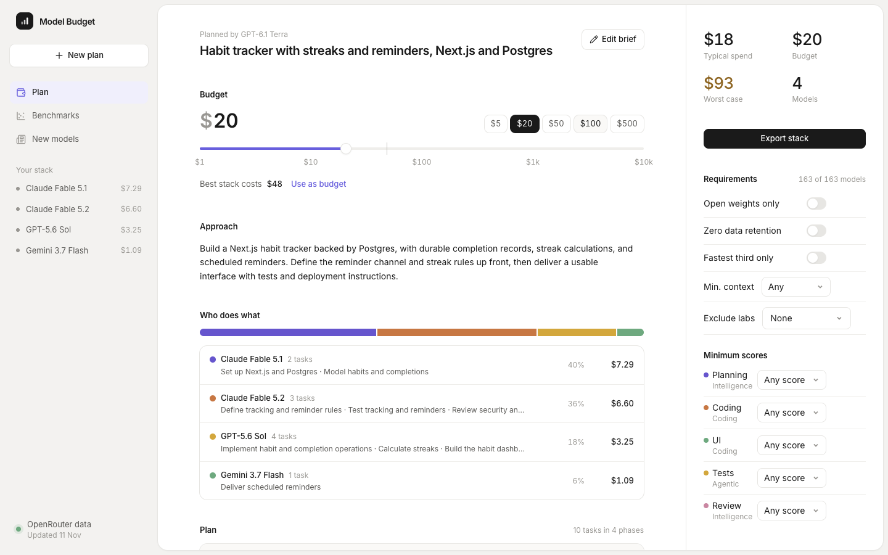
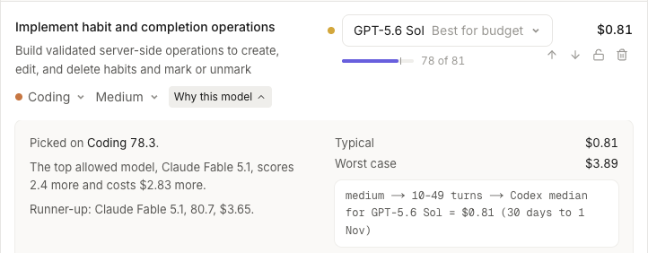
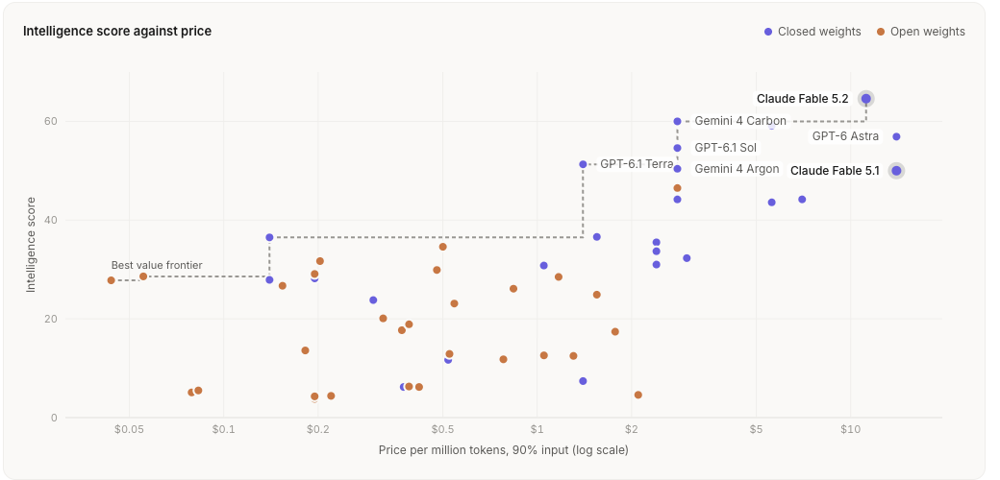

# Model Budget Planner

Plan a project, set a budget, and see which AI models to use for each part of it.

Try it: https://model-budget-planner.vercel.app



The #1 complaint me and other developers who build with AI have had lately is that it's just gotten too expensive. Online it's videos of Claude limits being used up after one prompt, and jokes about taking out a loan just to make a 3D model with GPT Astra. I faced this myself. I accidentally spent hundreds on coding agents because I thought I needed Fable to have a good outcome on my projects, when I could have been using lighter models for the tasks that don't need heavy reasoning.

Cheaper models are out there, but keeping up with AI is practically a full time job. New models and benchmarks come out every week, and only a small part of the AI native crowd knows which open-weight models are as good as closed source ones, which ones keep your data, or what's best for each kind of task. Everyone else just uses the most expensive model for everything.

So I built a planner that does that for you. You describe what you're building and set a budget, and a planning model breaks it into tasks: planning, coding, UI, tests, review, docs. Each task gets the best model your budget can afford, and "Why this model" shows the score it was picked on, the runner up, and how the cost was estimated. If the best stack costs less than your budget, it doesn't spend the rest. You can swap or lock any model and the rest rebalance, and set requirements like open weights only or zero data retention.



There's also a Benchmarks tab to see the landscape of all model benchmarks, a News tab for new model releases, and you can hover over the New badge to see what's new about a model compared to that provider's last one. When the plan looks right, you export it to Claude Code, Cline, or OpenCode.



I wanted to see the whole plan and what it costs before spending anything, so this stops at the plan. OpenRouter's Auto Code already picks models while you work, so I didn't build a router. Nothing routes at runtime, the export just puts each task's model in your coding agent's config, with a helper agent for each task type in Claude Code. It doesn't run the tasks either, since your coding agent already does that, and there are no accounts or saved plans because you use this once at the start of a project.

## How it's built

Every task type is matched to the benchmark that fits it from OpenRouter's Benchmarks API: coding for coding and UI, agentic for tests, intelligence for planning, review, and docs. To split the budget, every task starts on its cheapest option and keeps upgrading wherever it gets the most points per dollar until the money runs out. That logic is all pure functions with tests, so the numbers stay right when the UI changes.

For cost I didn't want to guess tokens, since most of what a coding agent costs is re-reading context and retrying. OpenRouter's Datasets API has the real median cost of Claude Code sessions per model, so each task's size maps to that. The Models API gives prices, release dates, and what the requirements filter on, and the Classifications API shows what each model is most used for.

The plan comes from Chat Completions with structured JSON output. It streams, so tasks show up one at a time instead of you staring at a spinner. It also sends your planning model plus the next two in the ranking as fallbacks, so if one is down you still get a plan. Only the server talks to OpenRouter, so the API key never gets to the browser.

I used my react-composition skill from [sjb-stack](https://github.com/SamanthaJeanneb/sjb-stack) while building so my coding agent kept the components clean. Built with Next.js, React, TypeScript, Tailwind, and Vitest.

## What I learned

The data didn't cover as much as I expected. Real session costs only exist for a few coding agents and 44 models, and there are no percentiles, just medians. So models without data get estimated from the closest priced model and labeled "estimated", and the worst case uses the median of the next session length up. A lot of models are also missing benchmark scores, so a task falls back to the intelligence score, and the planning dropdown only shows models that have one.

I also planned to set your spending cap from the app, but that needs a management key, so the export gives you the command instead. And Claude Code only has 4 model levels, which is why the export makes a helper agent for each task type with its own model.

## Run it locally

```bash
pnpm install
echo "OPEN_ROUTER_API_KEY=your-key" > .env.local
pnpm dev
```
